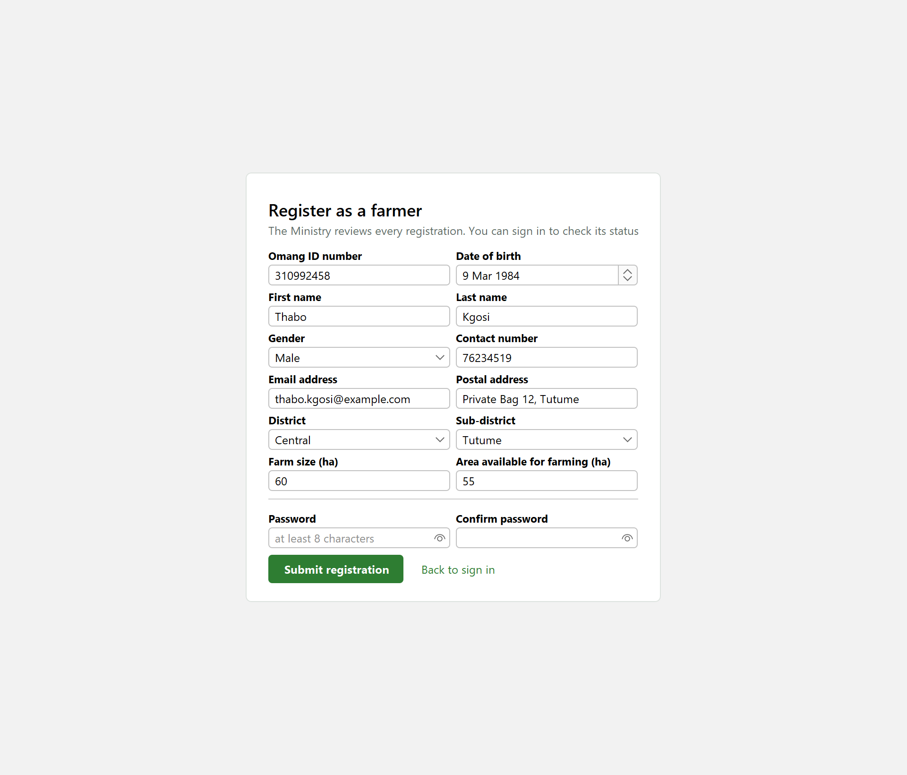
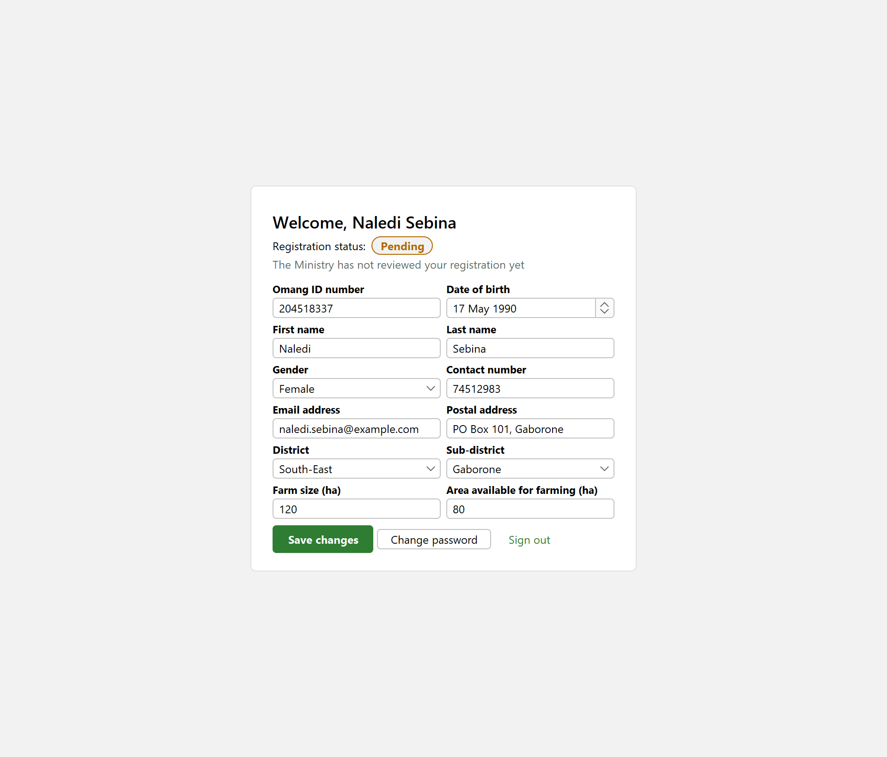
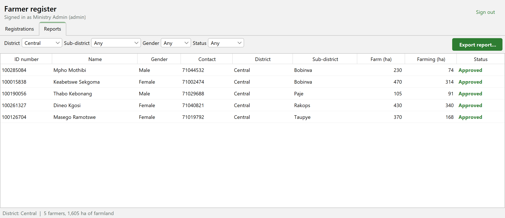
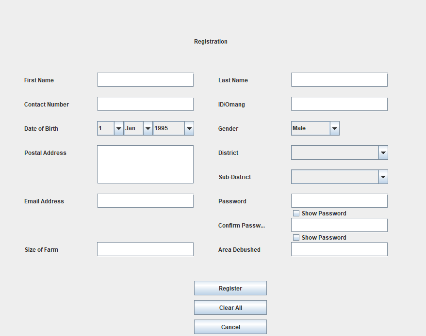
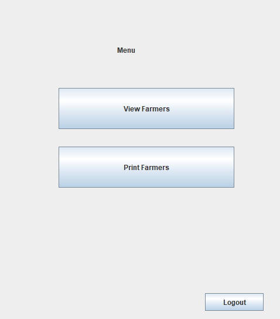

# FarmersBW: farmer registration system

> [!IMPORTANT]
> **This is a university project, not a real system.** I built it as an undergraduate Java assignment at
> BIUST. It is not affiliated with, endorsed by or used by the Ministry of Agriculture or any other
> government body, and it is not a working register of farmers. All farmer data in it is fictional.

A desktop app for registering farmers in Botswana, written as a coursework exercise. In the scenario the
assignment set, farmers sign up and keep their own details current, and a Ministry of Agriculture
administrator approves or declines registrations, edits records, and exports reports filtered by
district, sub-district, gender and status.

I first wrote it in 2022 as an undergraduate Java assignment, using Swing and MySQL. In 2026 I rebuilt it so
it runs from a fresh clone with one command. The original code is kept in this repo (see
[Project history](#project-history)).


## Run it

You need JDK 17 or newer. Nothing else: Gradle comes with the wrapper, and the database is an embedded
SQLite file.

```bash
./gradlew run --args="--demo"
```

On Windows, use `gradlew.bat` in place of `./gradlew`.

On first launch the app asks you to create the administrator account. `--demo` also adds 40 fictional
farmers, so the admin screens have something to show.

| Option | What it does |
|---|---|
| `--db FILE` | Use this database file. The default is `$FARMERSBW_DB`, or `~/.farmersbw/farmersbw.db`. |
| `--demo` | Add 40 fictional farmers if the database is empty. |
| `-h`, `--help` | Show usage. |

To get one runnable jar:

```bash
./gradlew uberJar
```

```bash
java -jar build/libs/farmersbw-2.0.0-all.jar --demo
```

## What it does

**Farmers**
- Sign up with their ID (Omang), contact details, date of birth, postal address, district and sub-district,
  farm size, and the area available for farming.
- See their registration status (Pending, Approved or Declined) and edit their details. If a declined
  farmer edits their details, the registration goes back to Pending for another review.
- Change their password.

**Administrator**
- See every registration in a sortable table, filtered by status, district and search text.
- Approve, decline, edit or delete a farmer.
- Export a report as an aligned text table (`.txt`) or as a spreadsheet file (`.csv`). Filter it by district,
  sub-district, gender and status. A [sample report](docs/sample-report.txt) is in `docs/`.

**Checks on input**: the ID is 9 digits, phone numbers are Botswana mobile or landline numbers, the farmer is
at least 16, the sub-district belongs to the chosen district, and the farming area is no larger than the farm.
Every problem is listed at once instead of one dialog at a time.

| Sign in | Register |
|---|---|
|  |  |

| Farmer profile | Reports |
|---|---|
|  |  |

## 2022 vs 2026

| 2022 | 2026 |
|---|---|
|  |  |
|  |  |
|  |  |

The 2022 screens were rendered from the original code in [`history/swing-2022`](history/swing-2022).

| | 2022 | 2026 |
|---|---|---|
| Build | IntelliJ project; MySQL driver added by hand | Gradle wrapper, `./gradlew run` |
| Database | Local MySQL server, `root` login hard-coded in the source | Embedded SQLite file, created and migrated on start |
| Passwords | Stored in plain text | PBKDF2-SHA256, 600,000 iterations, random salt per user |
| Setup | Import `farmersbw.sql` into MySQL by hand | Nothing to set up |
| Screens | A new window per screen, fixed pixel positions | One window, layouts that resize, FlatLaf theme |
| Admin | Inserted by hand in the SQL dump | Created in the app on first run |
| Reports | All farmers, written to a text file | Filtered text or CSV, with totals |
| Tests | None | 24 JUnit tests: validation, hashing, service rules, reports |
| Compiles on current JDKs | No (`case default:`) | Yes, with `-Werror` |

## Code layout

```
src/main/java/bw/farmers/
  App.java            start-up and command-line options
  model/              Farmer, User, Status, Gender, Districts, ReportFilter
  db/                 SQLite connection, migrations (schema.sql), repositories
  auth/               password hashing
  service/            validation and the rules for signing up, approving and editing
  report/             text and CSV reports
  demo/               fictional demo data
  ui/                 Swing screens
```

The screens call `FarmerService` only. They never touch SQL, so the rules are tested without a UI.

## Tests

```bash
./gradlew test
```

The tests run headless, each against its own in-memory database.

`./gradlew screenshots` regenerates the images in `docs/screenshots` from demo data. It needs a desktop
session.

## Project history

- **Tag [`original-2023`](https://github.com/mehdiacho/Farmer.Registration.System/tree/original-2023)**: the repository as it was before the 2026 rebuild.
- **[`history/swing-2022`](history/swing-2022)**: the original Swing + MySQL assignment, with only the May 2023
  compile fix applied. Its README and IntelliJ files are kept as they were.
- **[`history/android-2022`](history/android-2022)**: a start on an Android version (one dashboard screen),
  first kept in the separate `FarmersBW` repository. Its dashboard layout came from my
  [BIUST Hackfest 2022](https://github.com/mehdiacho/BIUST.Hackfest.2022) golf tournament app.
- In 2026 the git history was rewritten to replace real people's names, phone numbers, emails and passwords
  in the old SQL dump with fictional ones. Nothing else in the history changed: commits keep their
  original authors and dates.
