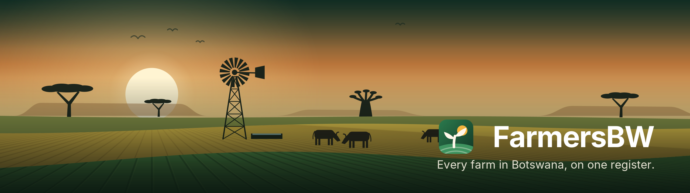
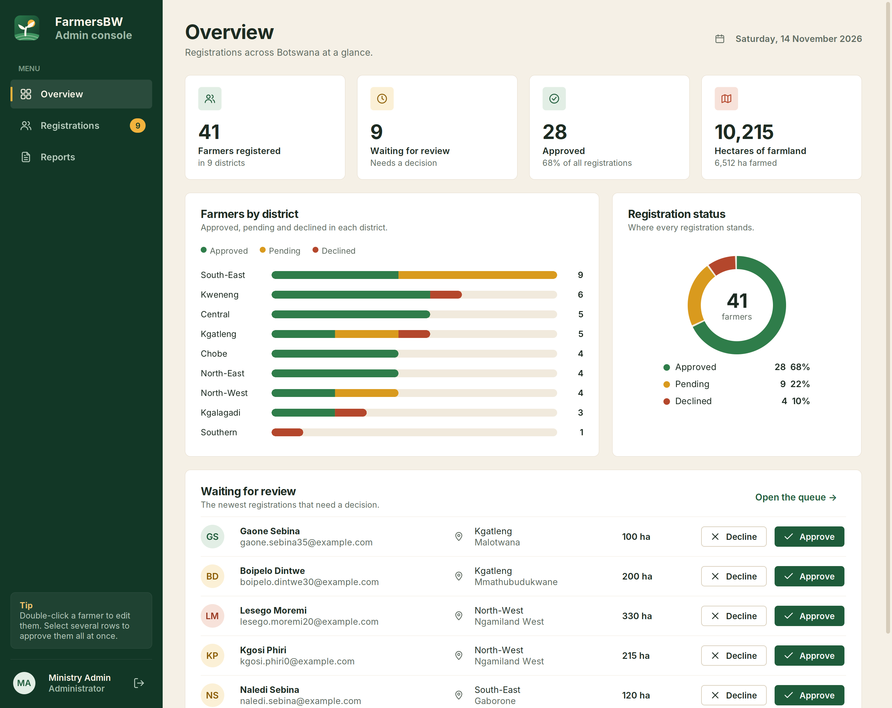
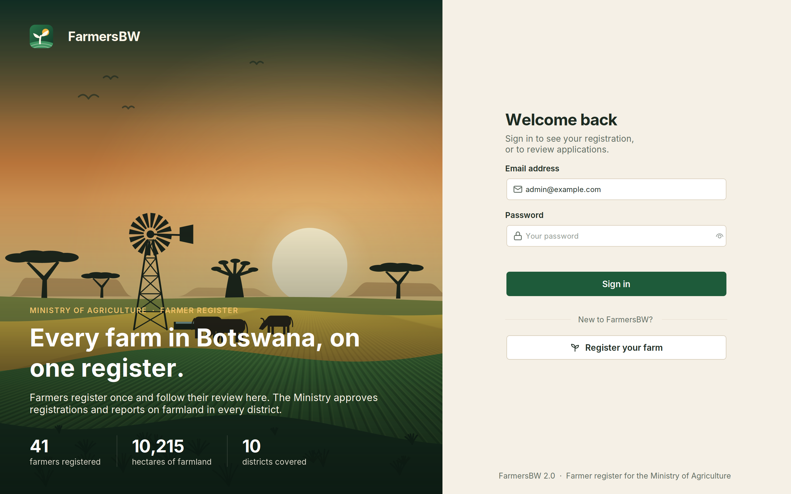
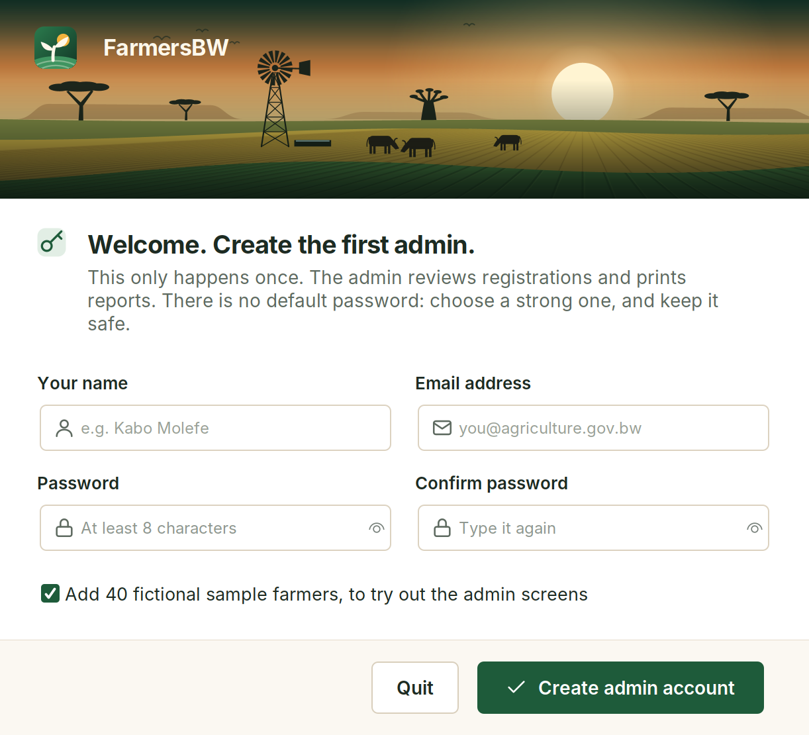
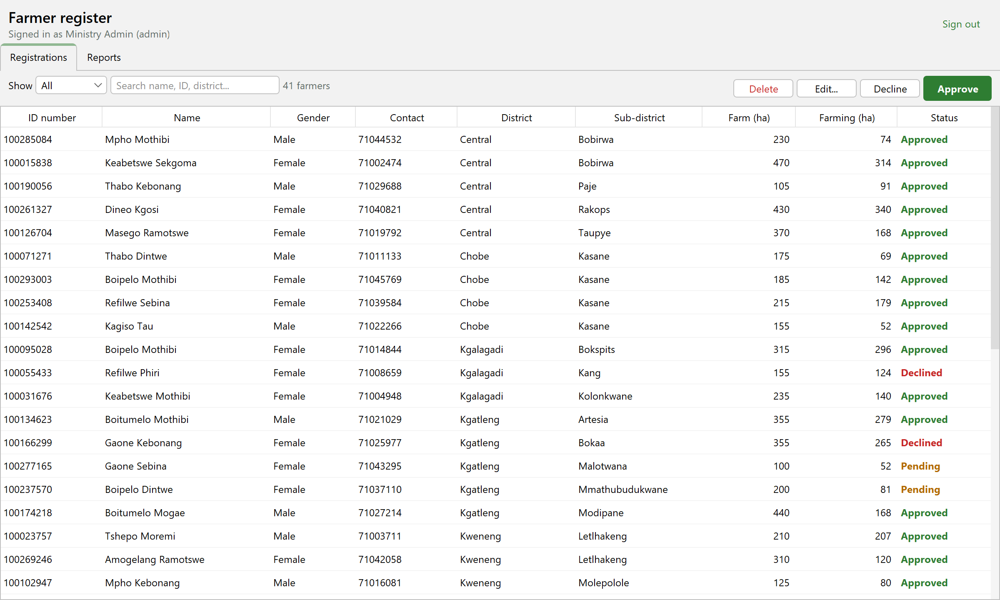
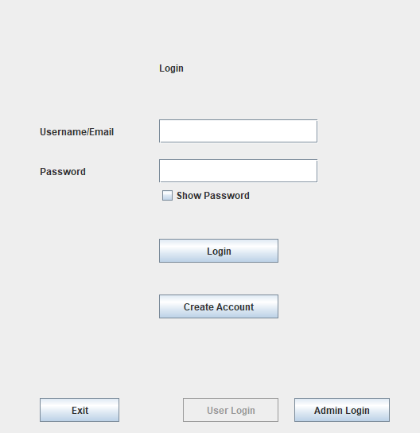

# FarmersBW: farmer registration system

A desktop app for registering farmers in Botswana. Farmers sign up and keep their own details current.
A Ministry of Agriculture administrator approves or declines registrations, edits records, and exports
reports filtered by district, sub-district, gender and status.

I first wrote it in 2022 as an undergraduate Java assignment, using Swing and MySQL. In 2026 I rebuilt it so
it runs from a fresh clone with one command. The original code is kept in this repo (see
[Project history](#project-history)).



## Download

Get the latest version from the [Releases page](https://github.com/mehdiacho/Farmer.Registration.System/releases/latest).
Each download comes with its own Java, so you install nothing else.

| Your computer | Download |
|---|---|
| Windows 10 or 11 | `FarmersBW-<version>-windows-x64.msi`: installs for your user, with Start-menu and desktop shortcuts. A portable `.zip` is there too. |
| macOS (Apple silicon) | `FarmersBW-<version>-macos-arm64.dmg`: drag the app into Applications. |
| Ubuntu / Debian | `FarmersBW-<version>-linux-amd64.deb`: `sudo apt install ./FarmersBW-*.deb` |
| Anything with Java 17+ | `FarmersBW-<version>-all.jar`: `java -jar FarmersBW-*-all.jar` |

The installers are not code-signed, so your computer warns you the first time. On Windows, click
**More info**, then **Run anyway**. On macOS, right-click the app, choose **Open**, then confirm. On first
launch the app asks you to create the admin account, and it can add 40 fictional sample farmers to try it out.

## Run from source

You need JDK 17 or newer. Nothing else: Gradle comes with the wrapper, and the database is an embedded
SQLite file.

```bash
./gradlew run --args="--demo"
```

On Windows, use `gradlew.bat` in place of `./gradlew`.

On first launch the app asks you to create the administrator account. `--demo` also adds 40 fictional
farmers, so the admin screens have something to show.

| Option | What it does |
|---|---|
| `--db FILE` | Use this database file. The default is `$FARMERSBW_DB`, or `~/.farmersbw/farmersbw.db`. |
| `--demo` | Add 40 fictional farmers if the database is empty. |
| `-h`, `--help` | Show usage. |

To get one runnable jar:

```bash
./gradlew uberJar
```

```bash
java -jar build/libs/farmersbw-2.0.0-all.jar --demo
```

## What it does

**Farmers**
- Sign up with their ID (Omang), contact details, date of birth, postal address, district and sub-district,
  farm size, and the area available for farming.
- See their registration status (Pending, Approved or Declined) and edit their details. If a declined
  farmer edits their details, the registration goes back to Pending for another review.
- Change their password.

**Administrator**
- An overview dashboard: totals, farmers by district, a status ring, and a review queue with one-click
  approve and decline.
- See every registration in a table, filtered by status and search text. Approve, decline, edit or delete
  several farmers at once.
- Export a report as an aligned text table (`.txt`) or as a spreadsheet file (`.csv`). Filter it by district,
  sub-district, gender and status. A [sample report](docs/sample-report.txt) is in `docs/`.

**Checks on input**: the ID is 9 digits, phone numbers are Botswana mobile or landline numbers, the farmer is
at least 16, the sub-district belongs to the chosen district, and the farming area is no larger than the farm.
Every problem is listed at once instead of one dialog at a time.

| Sign in | Register |
|---|---|
|  |  |

| Farmer page | First run |
|---|---|
|  |  |

| Registrations | Reports |
|---|---|
|  |  |

## 2022 vs 2026

| 2022 | 2026 |
|---|---|
|  |  |
|  |  |
|  |  |

The 2022 screens were rendered from the original code in [`history/swing-2022`](history/swing-2022).

| | 2022 | 2026 |
|---|---|---|
| Build | IntelliJ project; MySQL driver added by hand | Gradle wrapper, `./gradlew run` |
| Database | Local MySQL server, `root` login hard-coded in the source | Embedded SQLite file, created and migrated on start |
| Passwords | Stored in plain text | PBKDF2-SHA256, 600,000 iterations, random salt per user |
| Setup | Import `farmersbw.sql` into MySQL by hand | Nothing to set up |
| Screens | A new window per screen, fixed pixel positions | One window, layouts that resize, a custom FlatLaf design |
| Install | Run it from IntelliJ | Installers for Windows, macOS and Linux, with Java bundled |
| Admin | Inserted by hand in the SQL dump | Created in the app on first run |
| Reports | All farmers, written to a text file | Filtered text or CSV, with totals |
| Tests | None | 24 JUnit tests: validation, hashing, service rules, reports |
| Compiles on current JDKs | No (`case default:`) | Yes, with `-Werror` |

## Code layout

```
src/main/java/bw/farmers/
  App.java            start-up and command-line options
  model/              Farmer, User, Status, Gender, Districts, ReportFilter
  db/                 SQLite connection, migrations (schema.sql), repositories
  auth/               password hashing
  service/            validation and the rules for signing up, approving and editing
  report/             text and CSV reports
  demo/               fictional demo data
  ui/                 Swing screens; Ui.java is the design system, Landscape.java paints the farm scene
packaging/            installer icons and release notes
.github/workflows/    release.yml builds the installers when a v* tag is pushed
```

The screens call `FarmerService` only. They never touch SQL, so the rules are tested without a UI.

## Tests

```bash
./gradlew test
```

The tests run headless, each against its own in-memory database.

`./gradlew screenshots` regenerates the images in `docs/screenshots` from demo data. It needs a desktop
session.

## Releases

`./gradlew jpackage` builds a ready-to-run app folder with its own Java runtime in `build/jpackage/out`.
Add `-PinstallerType=msi`, `dmg` or `deb` to build an installer on that system. The MSI needs
[WiX 3](https://wixtoolset.org/docs/wix3/) on the PATH.

To publish a release, set `version` in `build.gradle.kts`, then push a tag:

```bash
git tag v2.0.0
```

```bash
git push origin v2.0.0
```

The [release workflow](.github/workflows/release.yml) runs the tests and builds the installers on Windows,
macOS and Linux. It then attaches them to a GitHub release, with notes from `packaging/release-notes.md`.
`./gradlew icons` regenerates the installer icons from the logo the app draws.

## Project history

- **Tag [`original-2023`](https://github.com/mehdiacho/Farmer.Registration.System/tree/original-2023)**: the repository as it was before the 2026 rebuild.
- **[`history/swing-2022`](history/swing-2022)**: the original Swing + MySQL assignment, with only the May 2023
  compile fix applied. Its README and IntelliJ files are kept as they were.
- **[`history/android-2022`](history/android-2022)**: a start on an Android version (one dashboard screen),
  first kept in the separate `FarmersBW` repository. Its dashboard layout came from my
  [BIUST Hackfest 2022](https://github.com/mehdiacho/BIUST.Hackfest.2022) golf tournament app.
- In 2026 the git history was rewritten to replace real people's names, phone numbers, emails and passwords
  in the old SQL dump with fictional ones. Nothing else in the history changed: commits keep their
  original authors and dates.
